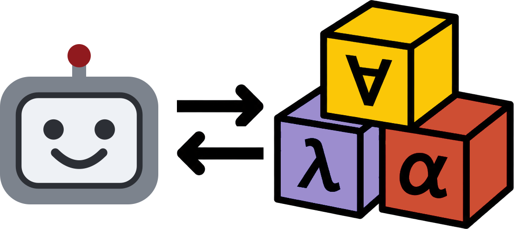

# Isabelle PIDE AI (formerly PIDE MCP)

**Agentic formal proof development with Isabelle: [formalproof.ai](https://formalproof.ai)**

This repository contains:
1. A server to **let AI agents interactively work with Isabelle** sessions, theories, and ML files via Isabelle/PIDE.
    Agents connect via the **Model Context Protocol (MCP) or command-based interaction**, over stdin/stdout or TCP. **Several agents can share one server**.
    The server is **headless** and **editor-agnostic**: you can let the agent work on its own or run it alongside Isabelle/jEdit or Isabelle/VSCode.
    The server is also **customizable** and **extensible**: you can freely add and remove background services, tools, and protocols.
1. A curated set of tools for typical Isabelle workflows (auto-formalization, state inspection, entity lookups, session management, etc.), supporting cancellation and progress reports.
1. A set of agent skills on how to effectively use the server and its tools and general guidance for formalization tasks and Isabelle.

**Find the [preprint here](https://hal.science/hal-05748384).**

**Hint:** If you have trouble installing, configuring, or running this project, 
ask your agent for help and point it to this README.


## Supported Isabelle Versions

PIDE AI releases are aligned with Isabelle releases.

- Every supported Isabelle release has a branch of this repository named after it (e.g. `Isabelle2025-2`). Use the branch matching your Isabelle release.
- Use branch `main` for PIDE AI's development version, which possibly requires a development version of Isabelle, documented in [ISABELLE\_VERSION](./ISABELLE_VERSION).

## Usage Notes

To get started (see details below), you install PIDE AI, connect it to an agent (via MCP or command-based interaction), and then you can start prompting.
To interactively explore the agent's changes, you may also run an Isabelle/jEdit or Isabelle/VSCode session next to the coding agent that uses the server (cf. screenshot).


**Take note of the following when using PIDE AI:**
- The server manages its own PIDE sessions. This means that **your editor's session and the server's sessions are independent of each other**.
    For example, commands will be processed by the server's sessions AND the editor's session,
    and Isabelle options passed to the editor session (e.g. base session and included session directories) also have to be passed to the server.
- **If you edit the same files as the server, it will only see your changes once they are written to disk.**
    The `file_watcher` service synchronises disk changes of loaded files to the PIDE session.
    Many tools further synchronise their used files with disk immediately.
    Vice versa, **if a file is edited via the server, you may need to manually reload the file in your editor** in case the editor does not auto-reload on disk changes.
    In Isabelle/jEdit, it is sometimes necessary to reload manually (e.g. by using the F5 key). Isabelle/VSCode supports auto-reload. 
    Avoid editing a file while the agent works on it. You might have to merge conflicts by hand otherwise.
- **By default, the server uses Isabelle symbols via Unicode (e.g. `∀`), including on disk**.
    This is done in order to save tokens when agents read and edit files directly.
    Use options `pide_ai_unicode_symbols_disk` and `pide_ai_unicode_symbols` to change the defaults.
    Note that some Isabelle tools, particularly `isabelle build`, require ASCII (e.g. `\<forall>`).
    The server converts sources to ASCII before builds (option `pide_ai_build_encode_symbols`). 
    Elsewhere, use `isabelle symbols` to recode files and sessions.
- If you want the agent to see proof states in pre-built base sessions, you have to build them with `-o show_states`. Note that such builds take significantly longer!
- PIDE AI clients pass a working directory to the server. Paths are read and printed relative to it.

## Installing PIDE AI

1. Install the supported Isabelle version. The supported version is stored in [ISABELLE\_VERSION](./ISABELLE_VERSION). Newer versions may also work (without guarantee). If you use a version compatible with an Isabelle release, [download it](https://isabelle.in.tum.de/). If you use a development version, insert the version number into the command below:
    ```bash
    hg clone https://isabelle.in.tum.de/repos/isabelle
    isabelle/Admin/init -r <VERSION_NUMBER>
    ```
    **Note for  macOS users:** on first start, macOS may block Isabelle. Open it, cancel the security dialog, then allow it in *System Settings → Privacy & Security* ("Allow Apps..."). See the [Isabelle installation notes](https://isabelle.in.tum.de/installation.html).

2. Clone and navigate into this repository. Then check out the branch matching your Isabelle version, as explained further above:
    ```bash
    git clone <THIS_REPOSITORY>
    cd isabelle-pide-ai
    git checkout <BRANCH>
    ```
    **Note for Windows users:** make sure that all `etc/settings` files use `LF` line breaks.

3. Register this project as an Isabelle component by inserting the file path to this project into the command below.
    ```bash
    isabelle/bin/isabelle components -u <PATH_TO_THIS_DIRECTORY>
    ```
    Note that this registers the component by path. If you move this directory later, you hence have to amend the registration.

4. Optionally register the [tool extensions](./Tool_Extensions), which add further tools (e.g. `sledgehammer`, build document output):
    ```bash
    isabelle/bin/isabelle components -u <PATH_TO_THIS_DIRECTORY>/Tool_Extensions
    ```

## Running the Server

**Note for Windows users:** You have to run below commands through Isabelle's cygwin (`isabelle/contrib/cygwin/bin/bash.exe`).

PIDE AI comes with two Isabelle tools:
- `isabelle pide_ai` serves protocols (MCP, command-based) on a TCP port.
- `isabelle pide_mcp` serves MCP over stdin/stdout. With `-p PORT`, it also serves protocols on `PORT` via TCP.

**Warning:** any local user can connect to a TCP port - there is no authentication!

Both tools take the same session options. You can start a server manually, either without any session
```bash
isabelle/bin/isabelle pide_mcp # or pide_ai
```
or with one or more sessions started automatically (use `-S` if using more than one session):
```bash
# start one HOL-based session
isabelle/bin/isabelle pide_mcp -l HOL
# start one HOL-based, one Pure-based, and one HOL-Analysis-based session
isabelle/bin/isabelle pide_mcp -l HOL -S "-l Pure" -S "-l HOL-Analysis"
```
As usual, all options are displayed using `pide_ai -?` and `pide_mcp -?`.
If everything is set up correctly, PIDE AI will be built automatically
and report its successful start.

Very likely, you want to connect the server to your agent:

## Connecting Agents

You have to set up two things for your agent: 
1. the **connection**, which tells the agent how to reach PIDE AI, and
2. the **agent skills**, which tell the agent how to use PIDE AI and Isabelle.

### Command-based Interaction

Agents can call PIDE AI's tools via command-based interaction, e.g. using the CLI clients in `AI/clients`:
```bash
# start a server on port 1234
isabelle/bin/isabelle pide_ai -p 1234 # or use -p 0 for any free port; the port will be printed on console
# then, in another shell
AI/clients/pide_ai_cli 1234 list_extensions show_input_schema:=true # or pide_ai_cli.ps1 in PowerShell (Windows)
```

Stop the server by stopping the process (Ctrl-C) or via the client `AI/clients/pide_ai_cli 1234 stop_server`.

**Note:**
- Unlike in MCP, agents can, in principle, observe progress of tool calls and filter results before reading them,
    which can improve token usage. Installation of a JSON processor (e.g. [jq](https://jqlang.org)) is recommended.
- Your agent needs the port. Tell it, or, if it is also connected via MCP using `pide_mcp -p PORT` (see below), it finds the port and CLI clients in its MCP instructions.

### MCP

**Note:** many files and folders mentioned below start with a dot (`.mcp.json`, `.opencode`,...).
Such files are often hidden by default in most file explorers and shells.

Most coding agents support global and local configurations:
- *Global configurations* apply every time you start the coding agent.
- *Local configurations* (typically) override global ones and only apply when you start the agent in the folder containing the local configuration.

We recommend the following:
1. A global configuration of PIDE AI's MCP server and its skills, without automatic session startups. This way, a light-weight server starts with every coding agent. The agent has the option to start Isabelle sessions on demand/instruction.
2. A local MCP configuration whenever a project should automatically start a set of sessions or include a special set of project options.

**Note:** the default MCP configurations connect via stdin/stdout only.
Add `-p PORT` (`-p 0` for any free port) to the config to also serve TCP, 
enabling command-based interactions (see above) and further MCP clients (`pide_mcp -p PORT -s`) on the same server (reachable by any local process).

#### Global Configuration

Copy the MCP entry of this repository's MCP configuration into your coding agent's global configuration file 
and the agent skills into its global skills folder. 
When doing so, **drop all session options (e.g. `-l HOL`)** so that the server starts without a session and 
**adjust the path to Isabelle** in the MCP configuration.

- For **OpenCode**, copy the `mcp` entry of `.opencode/opencode.json` into
    `~/.config/opencode/opencode.json` and the folders in `.opencode/skills` into `~/.config/opencode/skills`.
- For **Claude Code**, copy the `mcpServers` entry of `.mcp.json` into `~/.claude.json` and the folders
    in `.claude/skills` into `~/.claude/skills`.
- For **Codex**, copy the `mcp_servers` entry of `.codex/config.toml` into `~/.codex/config.toml` and
    the folders in `.agents/skills` into `~/.agents/skills`.

**Note for Windows users:** You may have to adapt the paths accordingly.
Consult your coding agent's documentation for its configuration and skill locations on Windows.

#### Local Configuration

Copy the configuration folders and files of this repository into your project.
You have to **adjust the path to Isabelle** and possibly the options you want to pass to the server (e.g. base sessions and included session directories).
Optionally remove the `skills` folder if you have already configured them globally.

- For **OpenCode**, copy/adjust `.opencode` and start OpenCode in the same directory.
- For **Claude Code**, copy/adjust `.claude` and `.mcp.json` and start Claude Code in the same directory.
- For **Codex**, copy/adjust `.agents` and `.codex` and start Codex in the same directory.

#### Checking the Configuration

Start your coding agent and let it list its MCP servers,
e.g. using `/mcp` in OpenCode, Claude Code, and Codex.
PIDE AI's MCP server (`isabelle-pide-mcp`) should be listed as connected.
If it is not, ask your agent for help
or consult your coding agent's documentation on how to inspect its MCP server logs.
Similarly, use `/skills` to check if this repository's agent skills are found.

#### Note for Windows Users

**Your coding agent has to open Isabelle via cygwin**. 
For example, in Claude Code, you can use the following MCP configuration (with adjusted paths and options):
```
      "command": "C:\\Users\\kevin\\isabelle\\contrib\\cygwin\\bin\\bash.exe",
      "args": ["--login", "-c", "\"C:/Users/kevin/isabelle/bin/isabelle\" pide_mcp -l HOL"]
```

### Agent Skills

The `skills` folders (identical copies in `.agents/`, `.claude/`, and `.opencode/`) contain the following guidance for AI agents.
- `isabelle`: Guidance for formalization and proof development.
- `isabelle-ml`: Guidance on Isabelle/ML.
- `pide-ai`: Guidance on using PIDE AI and its tools effectively.

You may adjust these guidances as you wish.

### Start Prompting

You can now start prompting your coding agent.
Remember that you can run Isabelle's editors (Isabelle/jEdit, Isabelle/VSCode)
on the same files at the same time (cf. screenshot above),
keeping the synchronization caveats from the [usage notes](#usage-notes) section in mind.
Check out the [quick start tutorial](https://formalproof.ai/quick-start/) to learn how to write your first agentic proof.

## Customisation

The server is extensible by:
- Services, which run in the background with session start and stop hooks.
- Tools, which are services offered to clients, additionally implementing a `handle` for tool calls.
- Protocols, which define how clients talk to the server (built in: `mcp` and `cmd`).

All are registered in the `services` field in `build.props` and selected at startup using the Isabelle options `pide_ai_KIND_include` and `pide_ai_KIND_exclude` for `KIND` in `services`, `tools`, and `protocols` (see [`AI/etc/options`](./AI/etc/options)).
- Disable them at compilation time by removing them from `services` in `build.props` or exclude them at startup using the options.
- Add them by adding the relevant source files to `sources` and the relevant class to `services` in `build.props` and include them in the options.
- Restart the server after editing the services or options.

You can either use PIDE AI's `build.props` (modify [`AI/etc/build.props`](./AI/etc/build.props))
or use a different Scala component:
1. Create a Scala component.
1. Add `env:ISABELLE_PIDE_AI_JAR` to the component's `requirements` in `build.props`.
1. Add your services' and tools' `sources` and `services`.
1. Register the component: `isabelle components -u <PATH_TO_THE_COMPONENT>`.
1. Include them in the options.

See [Tool\_Extensions](./Tool_Extensions) for an example of such a component.

## Known Limitations/Future Work

- There's a memory leak problem in PIDE that affects Isabelle/ML programming applications with PIDE AI, cf. this [email by Kevin Kappelmann](https://isabelle.zulipchat.com/#narrow/channel/247541-Mirror.3A-Isabelle-Users-Mailing-List/topic/.5Bisabelle.5D.20memory.20leak.28.3F.29.3A.20GC.20not.20reclaiming.20memory.20when.20.2E.2E.2E/with/629549584).
- It would be desirable to have the option to share a PIDE session among the server and editors (Isabelle/jEdit, Isabelle/VSCode).
    This requires changes in the Isabelle distribution sources.
- It would be desirable to explore changes with PIDE without altering the affected node's state,
    cf. this [email by Hanno Becker](https://isabelle.zulipchat.com/#narrow/channel/247541-Mirror.3A-Isabelle-Users-Mailing-List/topic/.5Bisabelle.5D.20Isabelle.2FREPL/near/581059372).
    This requires changes in the Isabelle distribution sources.
- Command timings for pre-built sessions are currently returned as 0.

## Related Work

- [I/Q](https://github.com/awslabs/AutoCorrode/tree/main/iq) is an alternative MCP server that provides an Isabelle/jEdit-centred workflow (using a shared document state).
- [IC2](https://github.com/awslabs/AutoCorrode/tree/main/ic2) is an alternative command-line tool that integrates with I/Q.

## Feedback, Questions, Discussions

Please use [this Isabelle Zulip stream](https://isabelle.zulipchat.com/#narrow/channel/202967-New-Members-.26-Projects/topic/PIDE.20MCP).
Alternatively, contact Kevin Kappelmann by email.

## Acknowledgments

- We thank Maximilian Schäffeler, Lukas Stevens, Mohammad Abdulaziz, Andrei Popescu, Dmitriy Traytel, Tobias Nipkow, Yong Kiam Tan, and Diego Marmsoler
for their helpful feedback and testing.
- Dmitriy Traytel co-authored the Isabelle/ML skill.
- Maximilian Schäffeler first investigated and suggested the command-based interactions, the `edit_get_state` tool, and the file watcher.

PIDE AI was developed as part of the [Copilots for Isabelle](https://www.renaissancephilanthropy.org/copilots-for-isabelle-learning-logical-structure-for-a-better-proving-experience) project, 
supported by the AI for Math Fund by Renaissance Philanthropy.

## Citation

Cite the [preprint](https://hal.science/hal-05748384): 
```
@misc{pide_mcp,
  title = {{PIDE MCP}: Connecting {AI} Agents to {Isabelle}},
  author = {Kappelmann, Kevin},
  year = {2026},
  doi = {10.5281/zenodo.21519364},
  url = {https://hal.science/hal-05748384},
  note = {Extended preprint of paper accepted at Workshop on Artificial Intelligence for Mathematics at the 19th Conference on Intelligent Computer Mathematics},
  hal_id = {hal-05748384}
}
```

Cite PIDE AI code release:
[](https://doi.org/10.5281/zenodo.21218654)
```
@software{pide_mcp_code_release,
  author     = {Kappelmann, Kevin},
  title      = {{Isabelle PIDE MCP}},
  license    = {LGPL-3.0},
  year       = 2026,
  publisher  = {Zenodo},
  version    = {2025-2-updated},
  doi        = {10.5281/zenodo.22726529},
  url        = {https://doi.org/10.5281/zenodo.22726529}
}
```

Cite this repository:
```
@software{pide_mcp_code,
  author  = {Kappelmann, Kevin},
  title   = {{Isabelle PIDE AI}},
  license = {LGPL-3.0},
  year    = {2026},
  url     = {https://github.com/kappelmann/isabelle-pide-ai}
}
```

